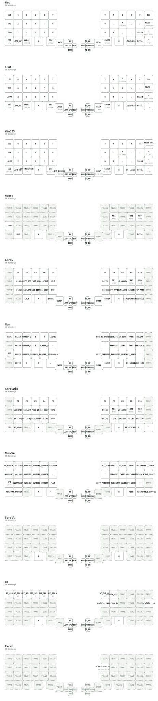

# Futhesia Moduora (MeKaBu) - フセシア・モデュオラ（メカブ）

[](https://github.com/te9no/zmk-config-MKB2/actions/workflows/build.yml?query=branch%3Amain)

```
                                                                                         
                                :-:                                                      
                               =@@@%=                                                    
                               .#@@@@%-                                                  
                                 =@@@@@=         :%%#:                                   
                    :*#*:         :@@@@@-        *@@@%                                   
                    +@@@@#.        +@@@@#        %@@@%                                   
                     =@@@@@-       -@@@@%       +@@@@*                                   
                      .#@@@@=      -@@@@%     .#@@@@%.                                   
                        #@@@@.     #@@@@=    =@@@@@%:                                    
                        :@@@@=    *@@@@*   -%@@@@@*                                      
                        :@@@@=   *@@@@#   +@@@@@*:   -#%#-                               
                        =@@@@.  =@@@@#   #@@@@#:    -@@@@%                               
                        *@@@#   %@@@@.  *@@@@=    .=@@@@@=                               
                        %@@@*   @@@@*  -@@@@-   :*%@@@@@=                                
                        #@@@#   #@@@=  #@@@=  .#@@@@@#+.                                 
                        =@@@@-  -@@@+  %@@*  :@@@@#=.                                    
         --.             +@@@@:  +@@%  #@@: :@@@#:                .--                    
       .%*=%*=======:     -%@@@=  *@@- *@@  %@@-      -==========*%+*%.                  
       :@*-%#++++++*@#.     -#@@#: #@# =@% +@%:     -%%++++++++++#@-+@:                  
        .==:        .*@+      :+@@= %@:-@*.@%.    .*@=            :==.                   
           .:         :#%=      .+@+-@*=@=#%.    +@*.            :.                      
         .%**%=-----:   -%#---:   +@*%%%@%@:  :=%#:   :--------=%**%:                    
         -@=-@#*****%#:   =***#%+*@@@@@@@@@%+#%*-   -%%********#@--@=                    
          :++-       +@#:      .+@@@@@@@@@@@*-    :#%=          -++-                     
                      .*@#*******%@@@@@@@@@@*****#@+                                     
                        .:::::::::::::::::::::::::.                                      
                                                                                         
```

A distributed knowledge-type input device discovered in Realm of Split IV.  
分割界・第四層で発見された集合知式入力装置群

## Classification | 分類
- **Species**: Synaptica Modularis (集合知式入力装置群)
- **Common Name**: MeKaBu (メカブ)
- **Origin**: Realm of Split IV (分割界・第四層)
- **Distribution**: Personal Workshops & Community Development Zones (個人工房、コミュニティ開発圏)
- **Nature**: Extensible, Autonomous, Harmonious (拡張可能・自律型・協奏性)

## Overview | 概要
Futhesia Moduora is an intellectually and structurally evolving input device born from the collective knowledge and experience of multiple developers. While based on a split-grid input surface, its form can be freely altered through external modules (known as Nodes).

フセシア・モデュオラは、複数の開発者が知識と経験を持ち寄ることによって生まれた、知的・構造的進化を続ける入力装置である。その外見は、左右に分かれた格子状の入力面を基軸としながらも、外部モジュール（通称：Node）によって自在に形を変える。

## Key Features | 特徴
- **Cognitive Lattice (知の格子)**: Key layouts designed at the intersection of functional beauty and logic
- **Modular Nexus (拡張構造)**: Freely interchangeable pointing devices, encoders, and sensors
- **Resonant Evolution (共鳴型進化)**: Organic integration of developer codes and designs
- **Tectonic Mode (テンティング適応)**: Physically adaptable form-factor

## Natural Habitat | 生態／運用環境
Thrives in collaborative environments, particularly hackathons and technical conventions.
単体での生息よりも、共創型の環境下において最も高いパフォーマンスを発揮する。

### Current Keymap Configuration | 現在のキーマップ構成


## Etymology | 語源
The name "MeKaBu" encompasses multiple meanings:
- Mechanical Components (メカニカルな部品群)
- Sprouting Stock - branching growth structure (芽株 - 分岐して増殖する構造)

---
*This configuration exists in the liminal space between reality and digital dreams.*  
*この設定は、現実とデジタルの夢の間の境界に存在する。*

---

## スクロール・AML・JISプロファイルの使い方

> このセクションの内容は設定ファイル上の変更です。実機での動作確認はまだ行っていません。

### レイヤー構成

| ID | 名前 | 役割 |
|---:|---|---|
| 0 | Def | 現行のベース (Mac/US 配列の OS 向け) |
| 1 | Fnc | Fn (従来どおり) |
| 2 | Num | 数字・記号 (従来どおり) |
| 3 | Mouse | 手動マウス層。AML の起動先でもある |
| 4 | Scr | ボールスクロール層 |
| 5 | BT | Bluetooth / プロファイル切替 |
| 6 | Auto Mouse | 互換用の空き枠。**使いません**(下記) |
| 7 | JIS | JIS プロファイルのベース (差分だけ定義、他は下層を透過) |
| 8 | JFnc | JIS 用 Fn (Windows のショートカット) |
| 9 | JNum | JIS 用 Num (日本語記号) |

既存の 0〜6 の ID は動かしていません。Studio で保存した 6 番の設定が新しい JIS 層に混ざらないよう、JIS 系は 7〜9 に追加しています。

### プロファイル切替

BT 層 (右端下段の Grave 長押し) を押したまま、**H = 現行プロファイル**、**J = JIS プロファイル**。

- 切替は「US→JIS 変換のオン/オフ」と「ベースレイヤー (0 / 7)」を同時に行います。Bluetooth のペアリングは変えません。
- どちらも保存しないので、**再起動すると現行プロファイルに戻ります**。
- JIS プロファイルを使うには、接続先 OS 側のキーボード配列を **JIS** にしてください。
- 変換の対象は `&kp` を通る US 記号です。Dvorak と Ctrl/Cmd 入れ替えは有効にしていません。

### エンコーダ

- 1 つ目のエンコーダを回すとマウスホイールのスクロールになります (Def / Mouse / Scr。JIS ベースは何も定義せず、これらを引き継ぎます)。右回りで下方向、左回りで上方向です。2 つ目は従来どおり PageUp/PageDown です。
- スクロール速度は `ZMK_POINTING_DEFAULT_SCRL_VAL` = 80 (`config/MKB.keymap` 先頭) で、1 ステップごとに `&msc` をこの速度パラメータで 20 ms タップします。実際のスクロール量はビヘイビアのレポート間隔と接続先 OS の設定に依存し、1 ステップが 80 ホイール単位になるとは限りません。
- Fn / Num / BT 層のエンコーダは従来どおり (音量・PageUp/PageDown) です。

### ボールスクロールと Fn 中のカーソル速度

- **K 長押し** または左親指の長押し (現行は LANG1、JIS は変換 `INT_HENKAN`、40 番) で Scr 層に入り、ボールがスクロールになります。
- Fn (JIS では JFnc) 長押し中はスクロールではなく、通常のカーソル速度の **半分** で動きます。離すと通常速度に戻ります。K / LANG1 / 変換の Scr 層は上記のとおりスクロールのままで、Fn と同時に押した場合は Scr 層が優先されます。
- この半分は、現在のランタイムのマウス設定を適用した後の値に対する比率です (Studio のマウス倍率が 2 倍なら、結果は 1 倍になります)。Fn 中のボール移動では、AML による Mouse 層の起動を行いません。実機では未確認です。
- Num / JNum 中は、従来どおりボールが矢印キーになり、カーソルは動きません。

### AML (ボールを動かすとマウス層が出る機能)

- AML はこれまでの専用の Auto Mouse (6) ではなく、**通常の Mouse (3)** を起動します。
- ボールを動かしたとき、直前 150 ms 以内にキー入力がなければ Mouse 層になります。最後のボール入力から 500 ms で戻ります。
- ランタイム入力プロセッサの名前を `aml` から **`aml3`** に変えました。以前 Studio で保存した `aml` の設定 (対象 6 番) が、この新しい対象を上書きしないためです。感度・方向・CPI などは変えていません。
- 6 番は使わない互換用の空き枠として残しています。
- Mouse 層ではベースの mod-tap (35, 36, 38 番) を明示的に重ねて書いています。AML はそのキーを押しても Mouse 層を維持するので、Shift / Ctrl / Cmd を押しながらのクリックができます。**ベース側のこれらのキーを変えた場合は、Mouse 層の同じ位置も同じに直してください。**

### 手動の Mouse 層

ホームポジション段の右端、`;` の右隣にある **`-` キー**: タップで `-`、200 ms 以上長押しで Mouse 層。長押し中は AML のタイムアウトやキー入力で層が消えないよう保護されます。離すと保護が解除され、その後は通常の AML の動作に戻ります (解除直後に短い待ち時間が入ることがあります。実機では未確認です)。

### 日本語記号 (JIS プロファイル)

- JIS 中の `&kp` は US 記号を自動で JIS キーに変換します。JNum (Num を長押し) では `` @ : ; ' " ^ _ ~ ` [ ] { } | `` と ¥ キーを入力できます。
- JNum は Num と同じ配置です。違うのは次の 7 か所です: 12 番 (Num では未使用) が半角/全角、左上 (CapsLock) が `^`、`NON_US_BACKSLASH` が ¥ キー、左下の角 (Ctrl/Esc の位置) が `|`、重複していた Enter のうち 37 番が `{`・41 番が `}`、`RS(GRAVE)` が `~` (JIS で正しく出るよう `&kp TILDE`)。
- ¥ キーは直接入力 (IME オフ) で **バックスラッシュ U+005C** を出します。フォントによって ¥ に見えます。
- zmk-layout-shift を v2 (`c242c13`) に上げ、`config/MKB_jis.dtsi` で `_`・`\`・`|` の出力を正しい HID 値に差し替えています。
- JIS 記号変換は左右どちらの Shift でも、両方同時に押した場合でも動作するよう、`config/MKB_jis.dtsi` で Shift 付きの変換を左 Shift・右 Shift・両方の 3 通りに展開しています。
- JIS プロファイルの違い: 下段左端 (36 番) の Ctrl/Esc が Win/Esc、スクリーンショットが Win+Shift+S、JFnc の Cmd 系ショートカットが Ctrl / Win 系 (Win+Tab、仮想デスクトップ移動、ウィンドウ分割など)。
- 日本語 IME (Windows、JIS): 現行プロファイルの Mac 用 LANG1/LANG2 は使いません。
  - 38 番: タップで **無変換** (`INT_MUHENKAN`)、長押しで Ctrl。
  - 40 番: タップで **変換** (`INT_HENKAN`)、長押しで Scr 層 (ボールスクロール)。
  - JNum の 12 番 (2 段目の左端、Num では未使用) に **半角/全角** (`LANGUAGE_5`) を置きました。Num (42 番) を長押ししながら押します。
  - 現行プロファイル (Default 0) の 38 / 40 番は変えていません。

### 保存済みの設定について

Studio で保存したキーマップはこのソースより優先されます。反映が見られないときは、先に Studio の設定を JSON でバックアップしてから、該当のバインディングだけを編集してください。どちらのリセットも必須ではありません。参考までに、`settings_reset` はボンド (ペアリング) を含む設定全体を初期化し、Restore Stock は保存済みのキーマップ関連設定だけを初期化します (ペアリングは消えません)。
